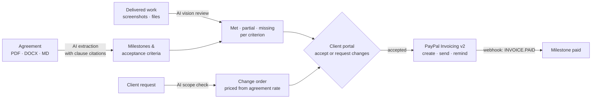

# ScopePay

**Connect the agreement, the delivered work, and the payment.**

**Live:** https://scopepay-wjm5.onrender.com · [Try the demo](https://scopepay-wjm5.onrender.com/demo) (no account needed)

ScopePay helps freelancers and small agencies get paid for agreed work without the back-and-forth. AI reads the signed agreement and turns it into milestones with checkable acceptance conditions, each citing its clause. When work is delivered, AI checks the screenshots and documents against every condition and flags what is missing. The client reviews the evidence and accepts. Acceptance issues a PayPal invoice, and the payment closes the milestone.

AI prepares the evidence. People make the decisions. PayPal moves the money.



## The demo in one story

A website agreement requires five pages in milestone 2. The designer uploads four screenshots.

1. **AI review** finds the Portfolio page **missing** and the Services page **partial** (three of the four required packages), each with the clause it breaks (§3.4, §3.3).
2. The designer uploads the fixes. The re-review shows **5 of 5 met**.
3. The client writes: *"Can you also add a blog?"* **AI scope check** flags it as out of scope (§5.1) and drafts a change order priced at the agreement's $95/hour (§5.2).
4. The designer shares the evidence pack. The **client portal** shows each screenshot next to each clause. The client types their name and accepts.
5. Acceptance creates a **PayPal sandbox invoice** with the approval details. The designer sends it, the client pays with the sandbox buyer account, and the **webhook** marks the milestone paid.

## How PayPal and AI are used

| Step | AI | PayPal |
|---|---|---|
| Agreement → terms | Structured extraction (forced tool call). Every quote is checked verbatim against the source text; unverified quotes and inconsistent totals are flagged before the freelancer confirms. | |
| Evidence review | Vision model inspects each screenshot and document text against each criterion, counts items, and links every verdict to evidence labels. | |
| Scope check | Classifies a client request against deliverables and exclusions, quotes the deciding clause, estimates hours for a change order. | |
| Client acceptance | | `POST /v2/invoicing/generate-next-invoice-number`, `POST /v2/invoicing/invoices` (idempotent `PayPal-Request-Id`, `Prefer: return=representation`) |
| Invoicing | | `POST /v2/invoicing/invoices/{id}/send`, payer link from `detail.metadata.recipient_view_url` |
| Follow-up | Drafts a short, friendly reminder that cites the approval date. | `POST /v2/invoicing/invoices/{id}/remind` |
| Payment | | Webhooks `INVOICING.INVOICE.PAID / UPDATED / CANCELLED`, verified with `POST /v1/notifications/verify-webhook-signature`; status refresh with `GET /v2/invoicing/invoices/{id}` as a fallback |

Human checkpoints are enforced by the server, not just the UI: terms are used only after the freelancer confirms them; a milestone can be shared only with a review that matches the current evidence; the client must type their name, and must explicitly acknowledge any open items; invoices are created only from a recorded approval.

## Run it locally

Requires Node.js 22+.

```bash
npm ci
npm start            # http://localhost:3000
```

With no keys, ScopePay runs in **demo mode**: rule-based extraction for the sample agreement, file-name matching instead of AI review, and simulated invoices. Every screen labels which mode is active.

To use the real integrations, copy `.env.example` to `.env` and fill in:

| Variable | Purpose |
|---|---|
| `OPENAI_API_KEY` or `ANTHROPIC_API_KEY` | AI extraction, vision review, scope checks, reminders. Optional `AI_MODEL`. |
| `PAYPAL_CLIENT_ID`, `PAYPAL_CLIENT_SECRET` | Sandbox REST app credentials ([developer.paypal.com](https://developer.paypal.com) → Apps & Credentials → Sandbox). |
| `PAYPAL_SANDBOX_BUYER_EMAIL` | Sandbox personal account. Prefilled as the client email so you can pay the invoice. |
| `PAYPAL_WEBHOOK_ID` | Webhook on the same app, pointing at `https://<host>/api/webhooks/paypal`, subscribed to `INVOICING.INVOICE.PAID`, `INVOICING.INVOICE.UPDATED`, `INVOICING.INVOICE.CANCELLED`. |
| `PUBLIC_URL` | Public base URL, used for client links inside invoices. |
| `DATABASE_URL` | Postgres connection string. Without it, data is stored as JSON files in `DATA_DIR`. |

PayPal calls go only to `api-m.sandbox.paypal.com`; production credentials are not supported by design.

## Deploy on Render

1. Render dashboard → **New → Blueprint** → select this repository (`render.yaml` is included).
2. Enter the secrets from the table above, and set `PUBLIC_URL` to the service URL.
3. In the PayPal sandbox app, add the webhook URL and copy its ID into `PAYPAL_WEBHOOK_ID`.

The blueprint also creates a free Render Postgres database and connects it through `DATABASE_URL`, so accounts, projects and evidence files survive restarts. Render's free database expires after 30 days unless its plan is upgraded.

## GitHub Pages

The public website is also published to GitHub Pages at https://moamryehia.github.io/ScopePay/ by `.github/workflows/pages.yml` on every push to `main`. `scripts/build-static-site.mjs` exports the pages as static files; the demo, sign-in and sign-up buttons point to the app on Render, since accounts, AI and PayPal need the server.

## The website and accounts

| Path | What it is |
|---|---|
| `/` | Landing page; also `/how-it-works`, `/pricing`, `/security`, `/privacy`, `/terms` |
| `/signup`, `/signin` | Accounts: email and password (scrypt-hashed), 30-day HttpOnly session cookie |
| `/app` | The freelancer app. Requires an account or the demo |
| `/demo` | Starts a demo workspace with the sample project, kept for 7 days of inactivity |
| `/portal.html#<token>` | The client's private review page; no account needed |

Each account sees only its own projects. Its business name appears on client review pages and PayPal invoices. Settings covers profile, password change and account deletion.

## Try it (2 minutes)

1. Open the site and choose **Try the live demo** (or create an account and add the sample project). Open **Website redesign** → milestone 2 → **Run AI review**.
2. Under *Demo files*, add **Portfolio page** and **Services page (fixed)**, then **Re-run**.
3. In **Scope checks**, click *"Can you also add a blog…"* → **Check against agreement** → **Send to client for approval**.
4. **Share for client acceptance** → **Open client view**. Type a name, accept the milestone, approve the change order.
5. Back in the workspace: **Send via PayPal**. Pay from the payer view with the sandbox buyer account (or **Simulate payment** in demo mode).
6. **New project → Use the sample website agreement** shows extraction with clause highlighting. Upload your own PDF or DOCX agreement with an AI key set.

## Tests

```bash
npm test                                   # unit tests: extraction grounding, AI and PayPal adapters (network mocked)
npm start & BASE_URL=http://localhost:3000 npm run test:e2e   # browser walkthrough of the full flow
```

The browser walkthrough uses Playwright (`CHROMIUM_PATH` to use an installed Chromium) and writes screenshots to `test-results/`. It runs in demo mode in CI, and against live AI and PayPal sandbox when keys are set.

## Project structure

```
server/
  index.js        HTTP server, API routes, client portal, webhook receiver
  workflow.js     state machine: evidence → review → approval → invoice → payment
  paypal.js       Invoicing v2 adapter, webhook verification, simulated adapter
  ai/provider.js  OpenAI / Anthropic structured calls with image input
  ai/extract.js   agreement extraction and quote grounding
  ai/evidence.js  vision review of deliverables
  ai/scope.js     scope checks, change orders, reminder drafts
  store.js        Postgres or JSON-file storage: projects, users, sessions, evidence files
  auth.js         accounts: password hashing, sessions, throttling, profile, deletion
  site.js         renders the public website pages into a shared layout
public/           app, client portal, website styles, self-hosted fonts, screenshots
site/             public website pages (landing, how it works, pricing, security, legal, sign in)
samples/          sample agreement and evidence screenshots (scripts/ regenerates them)
tests/            unit tests and the end-to-end walkthrough
```

## Limits

This is a hackathon project. Accounts have no email verification or password reset yet, since that needs an email provider. AI verdicts can be wrong, which is why every verdict shows its evidence and clause, and the client makes the decision. Website screenshots are produced by `scripts/capture-site-images.mjs`; re-run it with an AI key set to show real AI verdicts.

## Built with

Node.js · PayPal Invoicing v2 REST API and webhooks (sandbox) · OpenAI or Anthropic models (vision and tool use) · unpdf · mammoth · Playwright · Render

## License

[MIT](LICENSE)
